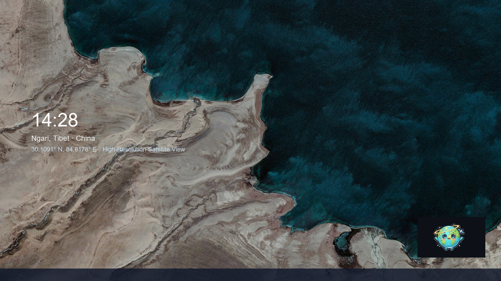
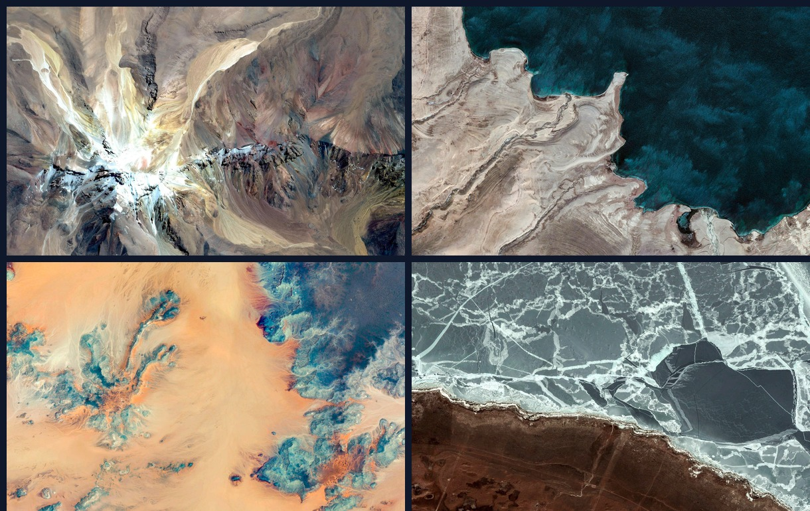

# Earth Tabliss 🌍

> A lightweight, minimalist live wallpaper for Windows featuring 1,500+ curated high-resolution satellite landscapes from Google Earth View, integrated with Tabliss-inspired typography and geological AI analysis.

  
  
  
  
  

  

## ✨ Highlights

* **1,500+ Satellite Views**: Curated landscapes from Google Earth View across deserts, glaciers, reefs, and salt flats.
* **0 FPS Zero-Overhead Engine**: Halts redraw loops once the 0.6s wallpaper transition finishes. Idles at **~0.0% CPU**.
* **Clean System Teardown**: Hooks non-destructively to Windows `WorkerW`. Automatically backs up and restores your original wallpaper on exit.
* **Ask Gemini**: Instant geological and satellite reasoning powered by **Gemini 4 Hydrogen** (`gemini-4-hydrogen`).
* **Visual Bookmarks Hub**: Save and organize your favorite coordinates with instant cached satellite thumbnails.

  

## 🚀 Download & Run

1. Download **[EarthTabliss-v0.2.0-win-x64.zip](https://github.com/hawaka6667-dev/earth-tabliss-wallpaper/releases/latest/download/EarthTabliss-v0.2.0-win-x64.zip)** (Portable, No Installation Required).
2. Unzip anywhere and double-click `EarthWallpaper.exe` (or `start.bat`). Enjoy your new desktop!

## 📄 License
[MIT](LICENSE) · Imagery © Google Earth View.
