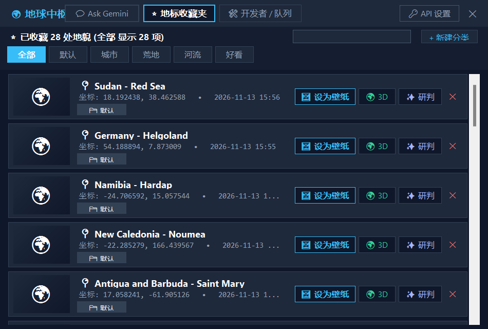
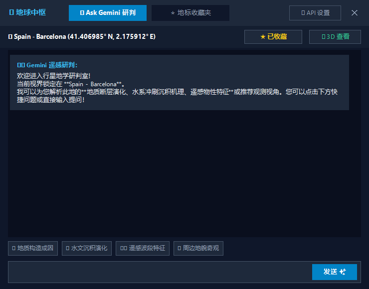
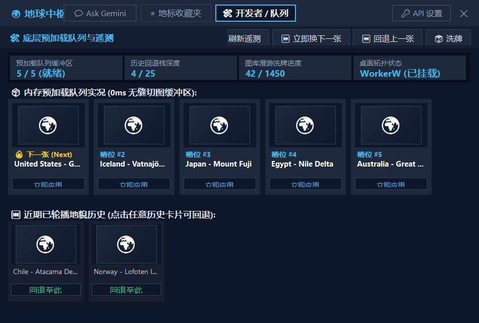

# Earth Tabliss Wallpaper 🌍✨

<p align="center">
  
</p>

<p align="center">
  <strong>静谧星河，俯瞰山川 —— 专为极简主义者与探索者打造的 Windows 极简地球动态壁纸与灵动桌面伴侣。</strong>
</p>

<p align="center">
  
  
  
  
  
  
</p>

---

## 🌟 为什么选择 Earth Tabliss？

在快节奏的工作流中，桌面不应是杂乱的堆积场，而应是开阔视野的窗景。

**Earth Tabliss** 融合了 **Tabliss 极简排版美学**、**Google Earth View 1500+ 精选高分辨率卫星影像**、**卡片式地标收藏夹**以及 **Google Gemini 遥感地貌研判智能**。不仅赋予桌面纯粹深邃的宏观美感，更带来了一位温润陪伴、绝不越俎代庖的卡通小地球桌宠。

<p align="center">
  
</p>

---

## ✨ 核心产品亮点

### 🍃 1. 极致能效，0 FPS 零闲置开销 (Zero-Overhead Efficiency)
- **静态零帧率引擎**：采用双缓冲无循环渲染技术，仅在壁纸切换的 0.6 秒内执行平滑微淡入，静止时**完全停止重绘 (0 FPS)**。
- **极端硬件友好**：深度适配轻量 CPU 平台（如 Intel Celeron 4 核），常驻后台 CPU 占用仅约 **0.0% ~ 0.5%**，内存开销轻盈，无风扇狂转，无续航焦虑。

### 🐾 2. 桌面级自洽伴侣，左右键独立管理 (Decoupled Desktop Pet)
- **绝不霸占顶层**：挂载于 Windows 桌面底层 (`WorkerW`)。当您全屏编码、修图或浏览网页时，桌宠静卧在桌面底层；回到桌面时即刻显现，彻底告别“流氓置顶弹窗”。
- **左右键独立分治**：
  - **🖱️ 鼠标左键单击**：即刻唤起 / 收起交互气泡，查看当前地表并快捷操作（上一张、下一张、收藏、研判）。
  - **🖱️ 鼠标左键双击**：一键展开完整的 **地球中枢 (Gemini Hub)**。
  - **🖱️ 鼠标左键拖拽**：按住桌宠全屏幕自由挪动，内置任务栏安全边界自动吸附，松开即刻记忆坐标。
  - **🖱️ 鼠标右键单击**：弹出桌宠系统管理菜单（外观皮肤切换、显隐桌面图标、开发者队列监控、3D地球巡礼、退出）。

### ⭐ 3. 全新重构地标收藏夹，卫星缩略图秒开 (Visual Bookmarks Hub)
- **真实卫星高分缩略图**：引入异步两级缓存系统（内存字典 + 本地硬盘永久缓存），毫秒级极速渲染已收藏地貌。
- **智能分类与关键词搜索**：支持标签分类过滤（全部、城市、荒漠、河流、好看）与自定义新建分类；输入国家、地区或坐标即可实时模糊搜索。
- **一键重设壁纸与 3D 联动**：在卡片上一键将心仪地标设为当前壁纸，或直接唤起 Google Earth 3D 飞跃实景。

<p align="center">
  
</p>

### 💬 4. Ask Gemini 智能地貌研判 (Geomorphology Intelligence)
- **深度地理学科研判**：支持向 Gemini 提问任何地质成因、遥感水系、风蚀地貌或生态格局。
- **快捷分析 Prompt**：预置地质断层构造、色彩光谱反演、气候环境特征等一键研判模板。
- **灵活的 API 支持**：内置离线地貌知识推理引擎；支持在设置中轻松绑定个人 Gemini API Key（免费获取），解锁大模型深度流式研判。

<p align="center">
  
</p>

### 🛠️ 5. 开发者模式与底层预加载队列 (Preload Queue Telemetry)
- **双缓冲零黑屏机制 (Double-Buffered Engine)**：后台维护深度为 5 的内存图片预加载队列，轮换壁纸 0ms 瞬间点亮，彻底杜绝网络黑屏与穿帮。
- **可视化遥测面板**：向高级用户与开发者完全公开底层调度状态：
  - 实时缓冲区深度与就绪状态
  - 历史已轮播地貌回退栈（随时点击回退任意一张历史壁纸）
  - 1500+ 图库漫游洗牌进度
  - 桌面拓扑挂载状态（`WorkerW` 挂载健康度）
- **即时干预工具**：支持手动一键换下一张、回退上一张、重新洗牌与槽位定向应用。

<p align="center">
  
</p>

### 🛡️ 6. 宿主安全与无损退出 (Zero Host Pollution)
- **桌面图标一键显隐**：独立调度 `SysListView32` 视口，纯净呈现无遮挡的行星视界。
- **原壁纸完美恢复**：启动时自动无损备份系统原始壁纸路径，退出程序时 100% 优雅还原原壁纸与桌面图标，完整释放所有系统 GDI 与句柄资源。

---

## 🎮 操作与手势指南 (Control Matrix)

| 操作方式 | 作用对象 | 交互行为与说明 |
| :--- | :--- | :--- |
| **左键单击 (Single-Click)** | 桌面桌宠 | 呼出 / 隐藏地标对话气泡（带快捷切图、收藏、研判按钮） |
| **左键双击 (Double-Click)** | 桌面桌宠 | 快速展开「地球中枢 (Gemini Hub)」大面板 |
| **左键长按拖拽 (Drag)** | 桌面桌宠 | 全屏幕平滑拖移位置，边缘避让任务栏，松开自动保存 |
| **右键单击 (Right-Click)** | 桌面桌宠 | 呼出管理菜单（皮肤切换、桌面图标、收藏夹、开发者队列、退出） |
| **托盘图标右键** | 系统托盘 | 打开系统级功能菜单（含快捷切图、API设置与开发者模式） |
| **ESC 键** | 中枢面板 | 快速关闭任何当前处于激活状态的弹出窗口 |

---

## 🚀 极速上手 (Quick Start)

### 系统要求
- **操作系统**：Windows 10 / Windows 11 (64位)
- **运行时环境**：[.NET 10.0 Runtime](https://dotnet.microsoft.com/) 及以上
- **浏览器内核**：[Microsoft Edge WebView2 Runtime](https://developer.microsoft.com/en-us/microsoft-edge/webview2/) (Windows 11 已自带)

### 下载与运行

#### 方式一：一键启动（免配置）
1. 克隆或下载本项目至本地硬盘：
   ```bash
   git clone https://github.com/hawaka6667-dev/earth-tabliss-wallpaper.git
   ```
2. 双击根目录下的 `start.bat`，即可一键点亮地球壁纸与桌宠伴侣。

#### 方式二：从源代码编译
```bash
# 1. 还原并编译 .NET 项目
dotnet build EarthWallpaper/EarthWallpaper.csproj -c Release

# 2. 运行壁纸宿主
./run-wallpaper.ps1
```

---

## 🔑 配置 Gemini API Key (可选)

Earth Tabliss 内置了离线地质推理机制，不配置 API Key 也可顺畅使用全部核心功能。若需要调动 Google 最新 Gemini 2.5 Flash 大模型执行深度分析：

1. 前往 [Google AI Studio](https://aistudio.google.com/) 免费创建您的个人 API Key。
2. 右键小地球或点击中枢右上角的 **「🔑 API 设置」**。
3. 填入 Key 并保存，即可畅享实时流式地貌研判！

<p align="center">
  
</p>

---

## 🏗️ 架构与工程规范

```
earth屏保/
├── EarthWallpaper/            # Windows 原生宿主 (.NET 10 WinForms)
│   ├── Core/                  # 系统底层穿透 (WorkerW, DesktopWorker, 电源策略)
│   ├── Models/                # 数据契约 (LocationInfo, QueueStatusInfo, BookmarkItem)
│   ├── Services/              # 业务持久化 (BookmarkManager, ThumbnailCache, GeminiService)
│   ├── UI/                    # 视觉呈现层
│   │   ├── Pet/               # 桌面伴侣 (EarthPetForm, PetBubbleForm, PetMenuForm)
│   │   ├── Hub/               # 控制中枢与标签页 (GeminiHubForm)
│   │   └── WallpaperForm.cs   # 桌面底层 WebView2 画布容器
│   └── Program.cs             # 进程互斥防多开与生命周期调度
├── app/                       # 静态前端呈现引擎 (HTML5/CSS3/ES6)
│   ├── assets/                # 离线底图、图标与桌宠高清贴图
│   ├── data/                  # 精选 1500+ Earth View 卫星地貌数据集
│   ├── app.js                 # 双缓冲零黑屏预加载队列驱动引擎
│   └── style.css              # Tabliss 极简排版与玻璃拟态质感主题
└── docs/                      # 宣传材料与功能实机验证图鉴
    └── images/
```

- **0 FPS 闲置原则**：严禁在壁纸中引入无意义的持续 WebGL/Canvas 高频渲染，保持纯净桌面静默。
- **状态持久化**：收藏夹数据保存在 `%LOCALAPPDATA%\EarthWallpaper\bookmarks.json`，缩略图持久化在本地硬盘缓存，支持随时备份迁移。

---

## 📄 开源许可证

本项目基于 [MIT 许可证](LICENSE) 开源。卫星影像与地貌版权归 Google Earth 所有。
