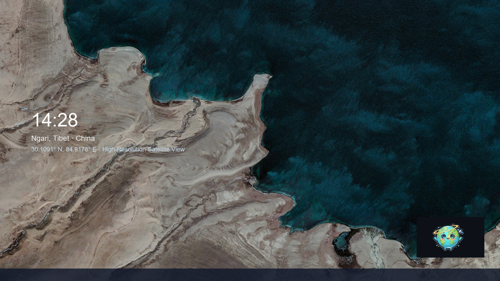
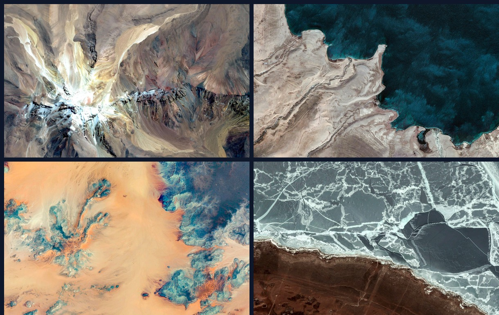
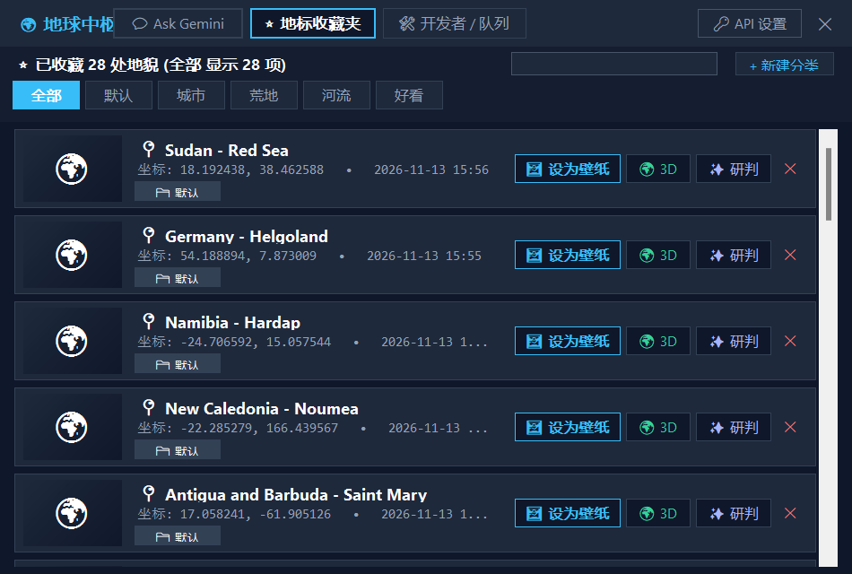
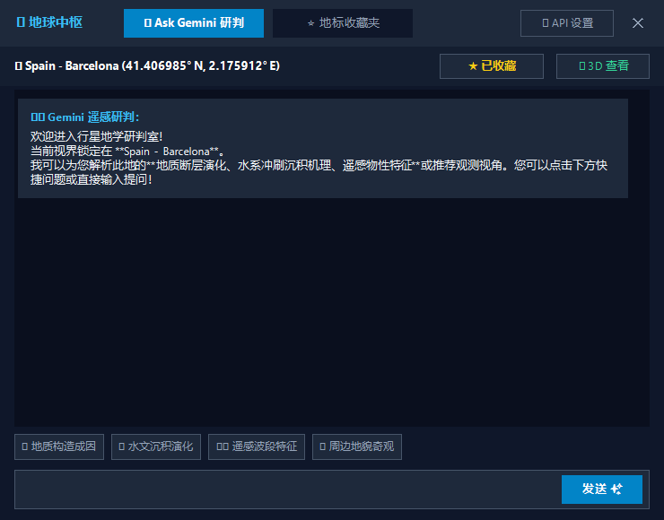

# Earth Tabliss Wallpaper 🌍✨

<p align="center">
  
</p>

<p align="center">
  <strong>静谧星河，俯瞰山川 —— 专为极简主义者与探索者打造的 Windows 极简地球动态壁纸与灵动桌面伴侣。</strong>
</p>

<p align="center">
  
  
  
  
  
  
</p>

<p align="center">
  <a href="README.md">English</a> • <a href="README.zh-CN.md">简体中文</a>
</p>

<p align="center">
  
</p>

---

## 🌌 产品总览

在快节奏的工作流中，桌面不应是杂乱的堆积场，而应是开阔视野的窗景。

**Earth Tabliss** 融合了 **Tabliss 极简排版美学**、**Google Earth View 1500+ 精选高分辨率卫星影像**、**卡片式地标收藏夹**以及 **Google Gemini 遥感地貌研判智能**。不仅赋予桌面纯粹深邃的宏观美感，更带来了一位温润陪伴、绝不越俎代庖的卡通小地球桌宠。

<p align="center">
  
  <br />
  <em>精选 1500+ 超高分辨率卫星影像，跨越七大洲沙漠、冰川、珊瑚礁与火山地貌。</em>
</p>

---

## ✨ 核心产品亮点

### 🖼️ 1. 精选超高分辨率 Earth View 卫星影像
* **1500+ 地球画卷**：汇聚全球地表奇观——断层构造、干涸盐湖、蜿蜒水系与冰川侵蚀。
* **极简时钟与地标排版**：纯净呈现当地时间、经纬度坐标与国家地区，无视觉噪声。
* **一键飞跃 3D 实景**：在气泡或卡片上一键唤起 Google Earth Web 飞跃三维实景。

### 🍃 2. 极致能效，0 FPS 零闲置开销 (0.0% CPU)
* **静态零帧率引擎**：采用双缓冲无循环渲染技术，仅在壁纸切换的 0.6 秒内执行平滑微淡入，静止时**完全停止重绘 (0 FPS)**。
* **极端硬件友好**：深度适配轻量 CPU 平台（如 Intel Celeron 4 核），常驻后台 CPU 占用仅约 **0.0% ~ 0.5%**，轻盈省电无风扇转动。

### 🐾 3. 灵动自洽伴侣，左右键独立分治
* **绝不霸占顶层与键盘焦点**：采用独立的 `WS_EX_NOACTIVATE` 悬浮工具窗，绝不抢占焦点，全屏编码或游戏时绝不遮挡。
* **左右键独立操作**：
  * **鼠标左键单击**：呼出 / 收起地标对话气泡（快捷切图、收藏、研判）。
  * **鼠标左键双击**：一键展开完整的 **地球中枢 (Earth Hub)**。
  * **鼠标左键拖拽**：全屏幕自由挪动，内置任务栏安全边界自动吸附，松开即刻记忆坐标。
  * **鼠标右键单击**：弹出桌宠管理菜单（皮肤切换、显隐桌面图标、收藏夹、开发者队列、退出）。

### ⭐ 4. 地标收藏夹，卫星缩略图秒开
* **两级持久化缓存**：内存字典 + 本地硬盘永久缓存，毫秒级极速渲染已收藏地貌的高清卫星缩略图。
* **智能标签与关键词过滤**：支持分类过滤（全部、城市、荒漠、河流、好看）与实时模糊搜索。
* **一键重设壁纸**：在卡片上一键将心仪地标设为当前桌面壁纸。

<p align="center">
  
</p>

### 💬 5. "Ask Gemini" 地质地貌遥感研判
* **深度地理科研解答**：向 Gemini 提问任何地质成因、遥感水系、风蚀地貌或生态格局。
* **采用前沿 Gemini 2.0 Flash**：主流高速低延迟大模型驱动，极速流式生成。
* **开箱即用与灵活配置**：内置离线知识推理引擎；可随时绑定个人 Gemini API Key（免费获取）。

<p align="center">
  
</p>

### 🛡️ 6. 宿主安全与无损退出
* **零系统污染**：不劫持 Windows 键鼠钩子，不污染 Explorer 线程。
* **原壁纸完美恢复**：启动时自动无损备份系统原始壁纸，退出时 100% 优雅还原原壁纸与桌面图标。
* **桌面图标一键显隐**：支持随时一键隐藏/恢复桌面图标，享受纯净全景壁纸。

---

## 🎮 操作与手势指南

| 操作方式 | 作用对象 | 交互行为与说明 |
| :--- | :--- | :--- |
| **左键单击** | 桌面桌宠 | 呼出 / 隐藏地标对话气泡（带快捷切图、收藏、研判按钮） |
| **左键双击** | 桌面桌宠 | 快速展开「地球中枢 (Earth Hub)」大面板 |
| **左键长按拖拽** | 桌面桌宠 | 全屏幕平滑拖移位置，边缘避让任务栏，松开自动保存 |
| **右键单击** | 桌面桌宠 | 呼出管理菜单（皮肤切换、桌面图标、收藏夹、退出） |
| **托盘图标右键** | 系统托盘 | 打开系统级功能菜单（含快捷切图、API设置与开机自启） |
| **ESC 键** | 弹窗面板 | 快速关闭任何当前处于激活状态的弹出窗口 |

---

## 🚀 极速上手

### 系统要求
* **操作系统**: Windows 10 (1903+) 或 Windows 11 (64位)
* **运行环境**: [.NET 10.0 Desktop Runtime](https://dotnet.microsoft.com/download/dotnet/10.0)（或兼容 .NET 8.0/9.0）
* **系统依赖**: Microsoft Edge WebView2 Evergreen Runtime（Win10/11 已原生内置）

### 运行方式
```bash
git clone https://github.com/hawaka6667-dev/earth-tabliss-wallpaper.git
cd earth-tabliss-wallpaper
dotnet run --project EarthWallpaper/EarthWallpaper.csproj
```
*或直接双击根目录下的 `start.bat`。*

---

## 📄 开源许可证

本项目基于 [MIT License](LICENSE) 开源。精选高分辨率卫星影像版权归 **Google Earth View** 及相应卫星遥感数据源所有。
